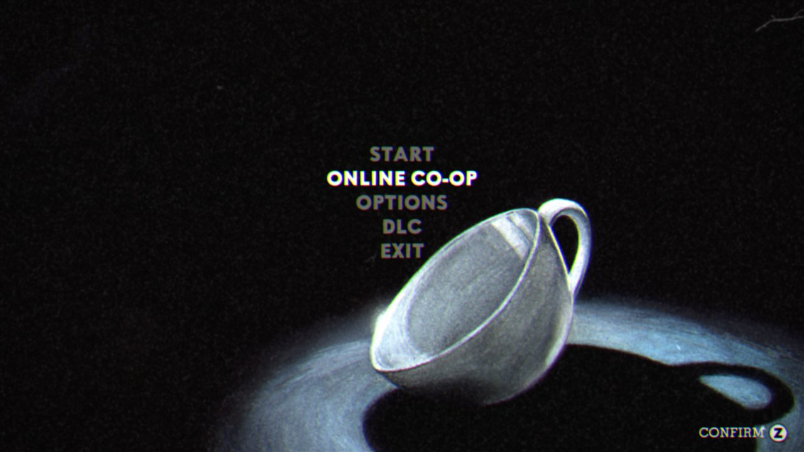

# Cuphead Online Co-op

**Gioca la modalità cooperativa di Cuphead con un amico su un altro PC: il gioco vero, a piena qualità, su entrambi gli schermi.**

*Mod amatoriale non ufficiale, non affiliata a StudioMDHR.* · [English](README.md)

## Cosa fa

- Tutto il gioco in co-op via rete: mappa, boss, livelli run 'n gun, negozi. È il co-op locale originale di Cuphead.
- Nessuno streaming video: il gioco gira su entrambi i PC e si scambiano solo i tasti premuti.
- Menu in stile nativo, in 12 lingue (segue la lingua del gioco).
- Installer con un clic, che trova Cuphead da solo e ha un pulsante per disinstallare.
- Salva solo nello slot dell'host; il PC dell'ospite non scrive niente.
- Se le due partite si discostano di poco, le corregge al volo senza mai ricominciare il livello.

## Installazione

1. Scarica `CupheadOnlineCoop-x.y.z.zip` dalla pagina [**Releases**](../../releases) ed estrailo.
2. Avvia **`CupheadOnlineCoop-Installer.exe`**: la cartella di Cuphead viene trovata da sola (altrimenti *Sfoglia…*).
3. Premi **Installa** e avvia Cuphead come sempre.

Installazione manuale: copia il contenuto di `manual-install` nella cartella di Cuphead. Per disinstallare: riavvia l'installer e premi **Disinstalla**.

Entrambi i giocatori devono avere la stessa versione del gioco, gli stessi DLC e la stessa versione della mod.

## Come si gioca

Menu principale → **CO-OP ONLINE**.
- **Host** (Giocatore 1): **CREA PARTITA** → scegli lo slot. In alto compaiono "In attesa del giocatore 2" e i tuoi IP.
- **Amico** (Giocatore 2): **UNISCITI** → scegli la partita trovata oppure **INSERISCI IP**.

Via internet serve che i due PC si vedano: stessa rete di casa, oppure **Tailscale** (consigliato), **Radmin VPN**, **ZeroTier**, oppure la porta **TCP 28147** aperta sul router dell'host. Con un ping sotto 80 ms si gioca benissimo; il cavo aiuta più di tutto.

Guida completa, impostazioni, problemi comuni e aspetti legali: vedi il [README in inglese](README.md).
