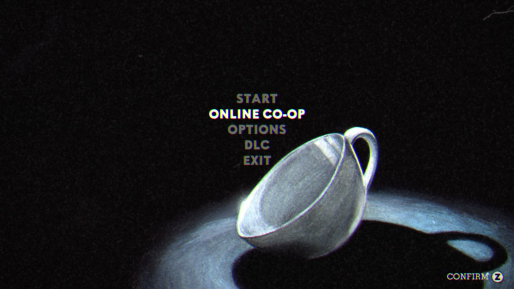
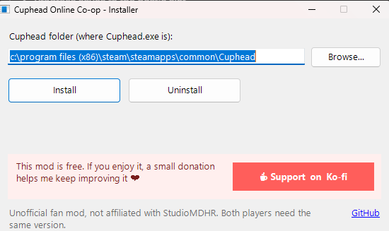
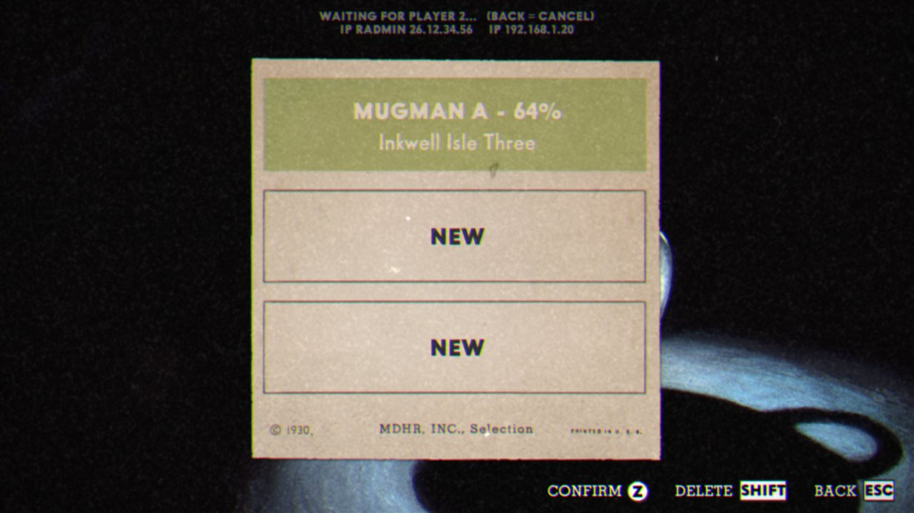
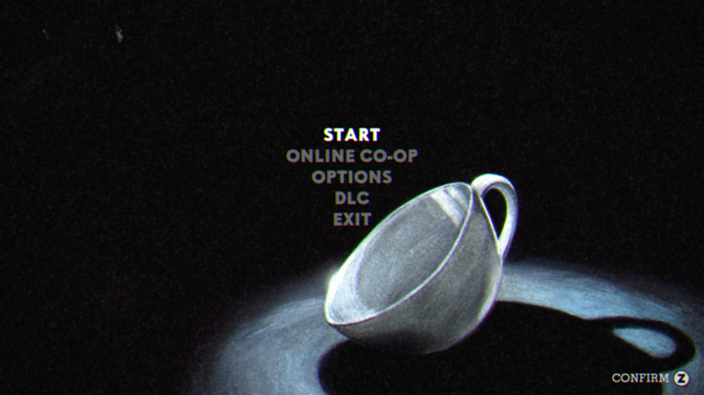
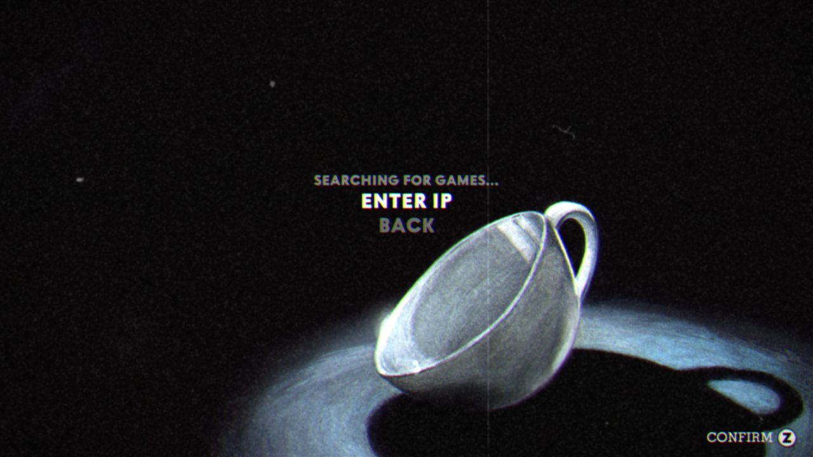

# Cuphead Online Co-op

**Play Cuphead's two-player co-op with a friend on another PC — the real game, at full quality, on both screens.**

[](https://github.com/Xillo23/CupheadOnlineCoop/releases/latest)
[](https://github.com/Xillo23/CupheadOnlineCoop/releases)
[](LICENSE)
[](https://ko-fi.com/xillo23)

*Unofficial fan mod. Not affiliated with or endorsed by StudioMDHR.* · [Italiano](README.it.md)



<p align="center"><b><a href="https://github.com/Xillo23/CupheadOnlineCoop/releases/latest">⬇️ Download the latest version</a></b> · <a href="#install">Install</a> · <a href="#how-to-play">How to play</a> · <a href="#playing-over-the-internet">Play over the internet</a> · <a href="#faq">FAQ</a></p>

<p align="center"><i>Free and open source, made in my spare time. If you have fun with it, you can</i><br>
<a href="https://ko-fi.com/xillo23"></a></p>

---

## Features

- **The whole game in co-op over the network**: it runs Cuphead's own local co-op, so map, bosses, levels and cutscenes behave exactly as with two controllers on one PC.
- **No video streaming**: both PCs run the game. Each player sees native resolution and frame rate and only sends button presses (a few bytes per frame).
- **Looks native**: the menus are built from the game's own menu, font and sounds.
- **12 languages**: the mod follows the game language (English, French, Italian, German, Spanish (Spain and Latin America), Korean, Russian, Polish, Brazilian Portuguese, Japanese, Simplified Chinese).
- **One-click installer**: finds Cuphead by itself (Steam / GOG) and has a clean Uninstall button.
- **Safe for saves**: progress is saved only in the host's save slot. The guest's PC writes nothing.
- **Self-correcting**: if the two games drift apart slightly, the mod fixes it on the fly. It never restarts the level.
- **Finds games automatically** on the same network and on most virtual LANs (e.g. Radmin VPN, ZeroTier). You can always connect by IP.

## Requirements

- Windows PC with **Cuphead** (developed and tested on the Steam version 1.3.4).
- **Both players** need the same game version, the same DLC (yes/no) and the same mod version. The mod checks this and tells you what is different.
- Each player needs their own copy of the game. This mod contains no game files.

## Install

1. Download `CupheadOnlineCoop-x.y.z.zip` from the [**Releases**](../../releases) page and extract it.
2. Run **`CupheadOnlineCoop-Installer.exe`**. The Cuphead folder is detected automatically; if not, click *Browse…* and pick the folder that contains `Cuphead.exe`.
3. Click **Install**, then start Cuphead as usual (from Steam).
<p align="center"></p>

> Windows SmartScreen may warn you because the installer is not signed by a company: click *More info → Run anyway*.
> If you prefer not to run it, use the manual install instead.

> ☕ **Enjoying the mod?** It's free and always will be. [A small tip on Ko-fi](https://ko-fi.com/xillo23) keeps updates and fixes coming.

**Manual install:** copy everything inside the `manual-install` folder into the Cuphead folder (next to `Cuphead.exe`).

**Uninstall:** run the installer again and click **Uninstall**. It removes only what it installed. If you already had BepInEx with other mods, those are left alone.

## How to play

Both players open Cuphead → main menu → **ONLINE CO-OP**.

| Host (Player 1, Cuphead) | Friend (Player 2, Mugman) |
|---|---|
| **HOST GAME** → pick the save slot as usual. The top of the screen shows *Waiting for player 2…* and your IP addresses. | **JOIN GAME** → pick the game from the list, or **ENTER IP** and type the host's address. |




| Join: games found automatically | Join: enter the host's IP |
|---|---|
|  |  |

The game starts on both PCs as soon as the friend connects. From then on it is normal Cuphead co-op. The session ends when the host returns to the title screen.

### Playing over the internet

The mod needs the two PCs to reach each other. Pick one option:

| Option | Setup | Notes |
|---|---|---|
| **Same home network** | nothing | Games appear automatically in *JOIN GAME*. |
| **[Tailscale](https://tailscale.com)** (recommended) | both install it and log in to the same network | Usually connects the two PCs directly → low ping. Use *ENTER IP* with the host's `100.x.x.x` address. |
| **[Radmin VPN](https://www.radmin-vpn.com)** / **[ZeroTier](https://www.zerotier.com)** | both join the same network | Games usually appear automatically. |
| **Port forwarding** | host opens **TCP 28147** on their router | Lowest possible ping. Friend uses the host's public IP. Not possible on some ISPs (CGNAT). |

The first time, Windows may ask whether to allow Cuphead on the network: allow it on **private** networks.

**Ping matters.** Both games advance together, so a late packet makes both wait a moment ("Slow connection: waiting for your partner…"). Under ~80 ms feels great. A wired connection helps more than anything else.

## Settings

The mod creates `BepInEx\config\it.cupheadlan.coop.cfg` the first time the game starts:

| Setting | Default | Meaning |
|---|---|---|
| `General.PlayerName` | *(computer name)* | Name shown to your partner |
| `General.Language` | `auto` | Mod text language: `auto` follows the game, or `en fr it de es es-419 ko ru pl pt-br ja zh` |
| `Network.TcpPort` | `28147` | Game port (same on both PCs) |
| `Network.DiscoveryPort` | `28148` | UDP port for finding games on the network |
| `Network.InputDelay` | `0` | Input delay in frames. `0` = automatic from ping |

## Troubleshooting

- **"Different installations" / "Different mod version"**: both PCs need the same game version, DLC and mods. The message lists the files that differ.
- **The friend can't find or reach the game**: try *ENTER IP*, check that both are on the same VPN network, and that Windows Firewall allows Cuphead.
- **Frequent "Slow connection"**: use a wired connection, close downloads and streaming, or try Tailscale / port forwarding instead of a relayed VPN.
- **Logs**: `BepInEx\coop-logs\` in the Cuphead folder. Please attach them (from both PCs) when you [open an issue](../../issues/new/choose).

## Updating

Download the new release and run its installer: **Install** over the old version replaces the mod and keeps your settings.
Both players must update, because different versions refuse to connect (the message says which version each side has).

## FAQ

**Do both players need the game?**
Yes. Both PCs run the game, so each player needs their own copy and the mod installed.

**Does it work with controllers / keyboard?**
Yes. Each player uses their own controls exactly as in single player. On each PC, use the controls you would use for Player 1. The mod assigns them to the right player.

**Whose progress is saved?**
The host's. The game uses the host's save slot (coins, weapons, bosses beaten), and the guest's PC writes nothing. Take turns hosting if you both want progress on your own saves.

**Can it work with more than two players?**
No. Cuphead's co-op is for two players.

**Does it use the internet, Steam or any server?**
No. The two PCs connect directly to each other (or through the VPN you choose). Nothing is sent anywhere else.

**Is it safe? Can I get banned?**
Cuphead is an offline game without online services or anti-cheat. The mod does not modify any game file: it only adds the BepInEx loader files, and Uninstall removes them. As with any mod, use it at your own risk.

**What about Steam achievements?**
The host earns them normally. The guest's PC writes nothing (no saves, no achievements) during a session.

## Status and known limitations

This is an early release (0.x). Played so far on two real PCs over the internet: the map, the Tutorial and several bosses, with progress saved normally.
Less tested: plane levels, the DLC, the GOG version, and game pause opened by the guest. Bug reports with logs are very welcome.

## How it works

The mod uses *deterministic input lockstep*, the technique classic fighting and strategy games use:

1. Both PCs run the full game. Player 1 is the host, Player 2 the guest, on both machines.
2. Every frame each PC sends only its own controller state. Frame *N* runs on both PCs with the same two inputs.
3. Time, randomness and loading are kept in step (fixed 60 FPS clock, synchronized random seeds, a loading barrier at every scene change).
4. Every second the two PCs compare a fingerprint of the game state. If a small difference appears, the host's values are copied to the guest on the same frame.

Built on [BepInEx](https://github.com/BepInEx/BepInEx) + [HarmonyX](https://github.com/BepInEx/HarmonyX). The game's files are never modified on disk.

## Building from source

Requirements: Windows, Cuphead with BepInEx 5.4.22 installed (the installer does that), and the .NET Framework 4 compiler that ships with Windows.

```powershell
.\build.ps1 -GamePath "C:\Program Files (x86)\Steam\steamapps\common\Cuphead"      # out\CupheadLanCoop.dll + tests
.\tools\MakeRelease.ps1 -GamePath "..."                                             # out\CupheadOnlineCoop-x.y.z.zip
```

The build references the game's assemblies from **your own installation**. No game code or assets are stored in this repository.


## Support the project

This mod took many evenings of reverse-engineering, testing and debugging, and it's free for everyone. If it gave you and a friend some good co-op nights, please consider supporting it:

<p align="center"><a href="https://ko-fi.com/xillo23"></a></p>

Donations are completely optional and unlock nothing: everyone gets the same mod. They help fund updates, more testing (plane levels, DLC) and new features.
Can't donate? **Starring the repo ⭐**, reporting bugs and sharing it with other Cuphead players helps a lot too.

## Legal

- This is a free, non-commercial fan project. **Cuphead** is a trademark of StudioMDHR Entertainment Inc. The mod is not affiliated with, endorsed or sponsored by StudioMDHR. All game content belongs to its owners.
- The repository and the releases contain **no game files**: you need your own legal copy of Cuphead. The game is not modified on disk. The mod is loaded at runtime by BepInEx.
- Screenshots show the mod's menus over the game's title screen, for illustration only.
- Third-party components are redistributed unmodified under their licenses. See [THIRD-PARTY-NOTICES.md](THIRD-PARTY-NOTICES.md).
- The mod's own code is released under the [MIT License](LICENSE).

If you are a rights holder and have a concern, please open an issue and it will be addressed promptly.
